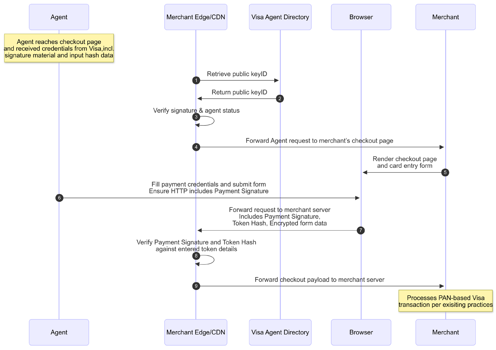

# Trusted Agent Protocol sample

A local demonstration of TAP agent request recognition using HTTP Message
Signatures. An agent signs a request, the proxy retrieves its public key from the
sample registry, and the proxy verifies the proof before forwarding protected
requests to the merchant API or product page.

Request recognition proves possession of a registered key and integrity of
covered components. Consumer consent, consumer/payment containers, payment
authorization, and settlement require separate verification. The storefront's
card checkout uses a mock processor; this is not a complete payment integration.

## Start here

| Goal | Entry point |
| --- | --- |
| Run the sample and send a real signed request | [Local quickstart](docs/quickstart.md) |
| Get oriented as a coding agent | [AGENTS.md](AGENTS.md) |
| Find the right guide for a task | [Documentation map](docs/README.md) |
| Understand request flow and trust boundaries | [Architecture](docs/architecture.md) |
| Work on TAP/RFC interoperability | [Protocol guide and authoritative sources](docs/protocol.md) |
| Make and test a contribution | [Development guide](docs/development.md), [CONTRIBUTING.md](CONTRIBUTING.md) |

## Services

| Component | Local port | Responsibility |
| --- | --- | --- |
| [Agent registry](agent-registry/README.md) | 9002 | Local agent/public-key registration and lookup |
| [Merchant backend](merchant-backend/README.md) | 8000 | Product, cart, and sample checkout/order API |
| [CDN proxy](cdn-proxy/README.md) | 3001 | Signature verification on configured routes and request forwarding |
| [Merchant frontend](merchant-frontend/README.md) | 3000 | React/Vite storefront; browse through proxy port 3001 |
| [TAP agent](tap-agent/README.md) | 8501 | Optional Streamlit signing/browser automation UI |

The optional registry Streamlit UI runs on 8502. The local registry is separate
from Visa's hosted registration services. Integer agent IDs and sample domains
are local identifiers, not Visa-issued credentials.

## Quick start

Use Python 3.11 and Node.js 22 or 24, matching regression CI. From the repo root:

```bash
python3.11 -m venv .venv
source .venv/bin/activate
python -m pip install -r requirements.txt
npm --prefix cdn-proxy install
npm --prefix merchant-frontend install
python scripts/check.py
```

Follow the [quickstart](docs/quickstart.md) to start the registry, backend, and
proxy, then run:

```bash
python scripts/demo_request.py
```

Expected output includes `unsigned=403, signed=200, replay=403`. The script
registers a throwaway local agent, signs a fresh protected GET request, and checks
replay rejection. It needs no browser, hosted API credentials, or real payment
data. The quickstart also explains optional storefront and browser-agent setup.

## Which requests require TAP?

| Proxy route | Policy |
| --- | --- |
| `/agent-api/...` | TAP required; forwarded to backend `/api/...` after verification |
| `/api/...` | Public storefront API |
| `/product/:id` | Existing TAP gate on the product-page network request |
| Other storefront pages | Public |

The public API serves the same catalog. The frontend does not sign ordinary API
calls, and client-side navigation does not create a new protected document
request. Use the explicit gateway when exercising request recognition.

The verifier supports Ed25519 and the sample's legacy RSA-PSS/SHA-256 maximum-salt
convention. It implements a supported subset of RFC 9421, requires TAP metadata
and the eight-minute maximum lifetime, and rejects unsupported declared coverage.
Replay protection is in memory for one process. See [protocol](docs/protocol.md)
and [architecture](docs/architecture.md) for the exact limits.

## Protocol references

Use [Visa's TAP merchant specifications](https://developer.visa.com/docs/trusted-agent-protocol/trusted-agent-protocol-specifications)
for TAP policy, [RFC 9421](https://www.rfc-editor.org/rfc/rfc9421.html) for HTTP
signature construction, and the [IANA registry](https://www.iana.org/assignments/http-message-signature/)
for registered names. Hosted API capabilities must be checked against the
corresponding authorized API documentation, not inferred from this sample.

The conceptual protocol diagram below covers broader interactions than the
request-recognition implementation in this repository:



See [LICENSE.md](LICENSE.md) for the repository license.
