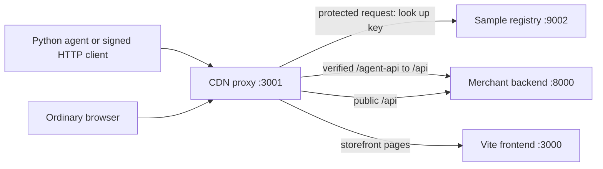

# Architecture and implementation boundaries

The sample recognizes a signing agent on selected routes. Its storefront, registry,
and checkout code provide a local demonstration around that recognition flow.

The Streamlit agent UI listens on 8501. An optional registry UI listens on 8502.
Backend and registry databases are separate SQLite files, relative to each
service's working directory. Start each service from its own directory.

## Follow a protected request

1. A client registers a public key in the sample registry and keeps its private key.
2. It signs the external authority and path, plus TAP metadata. Additional covered
   components bind method/query/fields when the client and verifier support them.
3. `cdn-proxy/server.js` mounts the agent gateway before the ordinary API proxy.
4. `cdn-proxy/agent-api.js` exposes the original external target to verification.
5. `cdn-proxy/tap-verifier.js` parses Structured Fields, checks the TAP profile,
   reconstructs covered values, and asks the registry for the key.
6. The registry's `/keys/{key_id}` lookup requires an active key and active parent
   agent. The verifier checks key metadata and the cryptographic signature.
7. The verifier rechecks expiry and claims the key-scoped nonce after success.
8. The gateway rewrites `/agent-api` to `/api` and forwards the request. Backend
   API redirects are rewritten back to the external protected prefix; the client
   must sign any redirected request afresh.

## Route policy

| External route on port 3001 | TAP required? | Destination |
| --- | --- | --- |
| `/agent-api/...` | Yes | Backend `/api/...` |
| `/api/...` | No | Backend `/api/...` |
| `/product/:id` | Yes, for the network request | React page |
| Other storefront pages | No | React pages |
| `/test` | No | Proxy diagnostic page |

The public API serves the same catalog. Recognition is not a confidentiality
boundary for that catalog. React client navigation can also render a product page
without making a new document request; the legacy product-page gate is not a
replacement for API policy. The frontend does not sign its ordinary API calls.

## What is and is not implemented

| Area | Current behavior | Boundary |
| --- | --- | --- |
| Request recognition | Ed25519 and the sample's legacy RSA-PSS/SHA-256 convention | A supported subset of RFC 9421, with explicit rejection of unsupported components |
| Registry | Local agent/key CRUD, active-state filtering | No hosted VARS integration or authenticated registration control plane |
| Replay checks | In-memory key/nonce store in one proxy process | Restarts and other workers do not share the store |
| Consumer recognition | Broader TAP specification describes it | No claim of complete consumer-container verification in this sample |
| Checkout | Local form/cart/order demonstration; card checkout uses a mock processor | Successful demo checkout is not evidence of a real payment |
| Additional payment routes | Finalize/fulfill and x402-style scaffolding in backend routes | Some paths expect a facilitator on port 8001, which is not included here |
| Legacy auth utilities | `/api/auth/verify-signature` calls an older Python helper; `/api/auth/check-verification` inspects headers | Neither utility gates the product/cart/order routers |

Request metadata, consumer data, and payment data have different verification
requirements. See the [protocol guide](protocol.md) before extending a boundary.
The current proxy uses direct HTTP and fixed local upstreams; deployment behind
TLS termination or multiple workers requires deliberate URL derivation, routing,
key-cache, and replay-store design.
