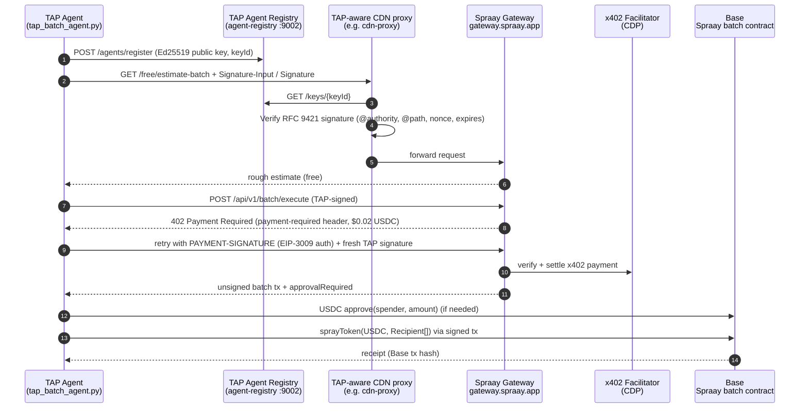

# Spraay Batch Settlement with a TAP-Verified Agent

This example shows a **Trusted Agent Protocol (TAP)** agent settling a **multi-recipient USDC batch payment on Base** in a single on-chain transaction, using [Spraay Protocol](https://docs.spraay.app).

TAP gives the agent a verifiable cryptographic identity (RFC 9421 HTTP Message Signatures). Spraay provides the settlement layer: one atomic, non-custodial transaction that pays up to 200 recipients. Together they show that **TAP's identity layer is rail-agnostic**. The same signed agent identity that authenticates a card checkout can also authenticate a stablecoin settlement request.

Spraay is a **complementary** settlement option for flows that need it, such as payouts to many parties at once. It does not replace card rails.

## Use cases

- **Marketplace vendor payouts**: an agent pays out every vendor's share of a settlement period in one transaction.
- **Fleet / gig driver settlements**: daily earnings to many drivers at once.
- **Multi-merchant orders**: one agent-initiated purchase that spans several merchants, each paid its portion.

In each case the payee side (or a CDN in front of it) can check *which agent* initiated the payout before acting on it.

## Relationship to PR #11

[PR #11](https://github.com/visa/trusted-agent-protocol/pull/11) adds **single-payment** x402 settlement. This example covers **batch** settlement: many recipients, one transaction. The two work together. Use x402 for one-to-one payments and Spraay batch for one-to-many.

## Architecture



**Two keys, two jobs:**

| Key | Purpose | Env var |
|-----|---------|---------|
| Ed25519 TAP identity key | Signs every HTTP request (RFC 9421). Registered in the agent-registry. | `ED25519_PRIVATE_KEY` / `ED25519_PUBLIC_KEY` |
| EVM wallet key (Base) | Pays x402 fees and signs/broadcasts the batch transaction. | `PAYER_PRIVATE_KEY` |

## How the TAP signature works here

Each request to the gateway carries the same header format that `tap-agent/agent_app.py` produces:

```
Signature-Input: sig2=("@authority" "@path"); created=<unix>; expires=<unix+480>; keyId="spraay-batch-agent-ed25519"; alg="ed25519"; nonce="<uuid4>"; tag="agent-payer-auth"
Signature:       sig2=:<base64 Ed25519 signature>:
```

The signature base is built the same way as in `tap-agent`:

```
"@authority": gateway.spraay.app
"@path": /api/v1/batch/execute
"@signature-params": ("@authority" "@path"); created=...; expires=...; keyId="..."; alg="ed25519"; nonce="..."; tag="agent-payer-auth"
```

A fresh nonce is generated for every request, including the paid retry after HTTP 402. `verify_tap_signature()` in the script shows what a verifier does: it rebuilds the base, checks `expires`, and verifies the signature with the public key from `GET /keys/{keyId}` on the agent-registry. The repo's `cdn-proxy` performs this same check.

## Spraay endpoints used

All requests go to `https://gateway.spraay.app`.

| Endpoint | Cost | Purpose |
|----------|------|---------|
| `GET /free/prices` | free | Token USD prices (ETH, USDC, SOL, USDG) |
| `GET /free/estimate-batch?recipients=N&token=USDC` | free | Rough estimate: protocol fee bps, estimated gas USD, supported chains |
| `POST /api/v1/batch/estimate` | $0.001 (x402) | Live gas and fee quote, `suggestedGasLimit` (decimal string) |
| `POST /api/v1/batch/execute` | $0.02 (x402) | Unsigned batch tx (`transaction.gasLimit` is hex) and `approvalRequired` |

- The paid endpoints are listed in the x402 manifest at [`/.well-known/x402.json`](https://gateway.spraay.app/.well-known/x402.json). Request and response schemas are in [`/openapi.json`](https://gateway.spraay.app/openapi.json). The `/free/*` endpoints are not part of the OpenAPI spec.
- x402 v2: a paid endpoint first answers `402` with a base64 JSON `payment-required` header. The agent signs an EIP-3009 `transferWithAuthorization` for USDC on Base (`eip155:8453`), payable to `0xAd62f03C7514bb8c51f1eA70C2b75C37404695c8`. It then retries with a `PAYMENT-SIGNATURE` header. The CDP facilitator (`https://api.cdp.coinbase.com/platform/v2/x402`) settles the payment.

### Batch payload

`example_batch.json` uses parallel arrays. `token`, `recipients`, `amounts`, and `sender` are all required for execute. `chain` is optional and accepts `"base"` (the default) or `"peaq"`. Any other value returns HTTP 400.

```json
{
  "token": "USDC",
  "chain": "base",
  "sender": "0x...",
  "recipients": ["0x...", "0x..."],
  "amounts": ["1500000", "2000000"]
}
```

**Amounts are RAW base-unit integer strings.** USDC has 6 decimals, so `"1500000"` is $1.50 and `"10000000"` is $10.00. Do not use human decimals. In responses, `batch.totalAmount`, `fee`, and `totalWithFee` are human-decimal strings for display. `approvalRequired.amount` is in raw base units; pass it verbatim as the ERC-20 allowance.

The script replaces `sender` with the address derived from `PAYER_PRIVATE_KEY`. The recipient addresses in the sample file are illustrative.

### On-chain details (Base)

- Spraay batch contract: `0x1646452F98E36A3c9Cfc3eDD8868221E207B5eEC`
- USDC: `0x833589fCD6eDb6E08f4c7C32D4f71b54bdA02913`
- Functions: `sprayToken(address token, Recipient[])`, `sprayETH(Recipient[])` (payable), `sprayEqual(address token, address[], uint256)`. `Recipient` is the struct `(address, uint256)`.
- Fee: 30 bps (0.3%), added on top of the total. The allowance (or `msg.value` for ETH) must cover total + fee, and excess ETH is refunded.
- Max 200 recipients per batch.

The script refuses to broadcast if the returned `transaction.to` is not the Spraay batch contract.

## Setup

```bash
cd examples/spraay-batch-settlement
python -m venv .venv && source .venv/bin/activate   # Windows: .venv\Scripts\activate
pip install -r requirements.txt

# 1. Create a TAP identity key and put it in .env (.env is git-ignored)
python tap_batch_agent.py --generate-keys >> .env

# 2. (Optional) register it with the repo's agent-registry
#    start the registry first: cd ../../agent-registry && python main.py
python tap_batch_agent.py --register
```

Optional environment variables:

| Variable | Default |
|----------|---------|
| `TAP_KEY_ID` | `spraay-batch-agent-ed25519` |
| `AGENT_REGISTRY_URL` | `http://localhost:9002` |
| `AGENT_DOMAIN` | `https://spraay.app` |
| `PAYER_PRIVATE_KEY` | required only for `--pay` |
| `BASE_RPC_URL` | `https://mainnet.base.org` |

## Run

```bash
# Dry run: TAP signing, free endpoints, shows the 402 payment terms. Spends nothing.
python tap_batch_agent.py

# Pays $0.001 + $0.02 in USDC via x402: live quote + unsigned batch transaction.
python tap_batch_agent.py --pay

# Also approves USDC and broadcasts the batch on Base. Prints the Base tx hash.
python tap_batch_agent.py --pay --broadcast

# Custom batch file
python tap_batch_agent.py --batch my_payouts.json
```

Example dry-run output:

```
=== 1. TAP identity ===
  keyId: spraay-batch-agent-ed25519  tag: agent-payer-auth
  Local verification (as a TAP CDN proxy would): True

=== 2. Batch ===
  token=USDC chain=base sender=0x1111111111111111111111111111111111111111
    0x2222222222222222222222222222222222222222       1500000 raw  (1.5 USDC)
    0x3333333333333333333333333333333333333333       2000000 raw  (2 USDC)
    0x4444444444444444444444444444444444444444      10000000 raw  (10 USDC)
    0x5555555555555555555555555555555555555555        750000 raw  (0.75 USDC)
  total 14.25 USDC + 0.3% protocol fee ~0.04275 USDC

=== 3. Free tier: /free/prices + /free/estimate-batch ===
  USDC=$0.999643  ETH=$2288.76  (cached=True)
  chain=base recipients=4 feeBps=30 estimatedGasUSD=0.066 supported=True chains=['base', 'peaq']

=== 4. Paid: POST /api/v1/batch/estimate ($0.001 via x402) ===
  HTTP 402 Payment Required -> 1000 raw USDC to 0xAd62f03C7514bb8c51f1eA70C2b75C37404695c8 on eip155:8453
```

With `--pay --broadcast`, the final step prints the settlement receipt:

```
=== 6. Settlement on Base ===
  Batch tx: 0x<hash>  status=success  block=<n>
  Receipt: https://basescan.org/tx/0x<hash>
```

## Security notes

- Never commit `.env`. This directory's `.gitignore` excludes it.
- Use a dedicated payer wallet holding only the USDC (and a little ETH for gas) the agent needs.
- `--broadcast` sends real funds on Base mainnet. Review the batch file before running it.

## References

- Spraay docs: https://docs.spraay.app
- Batch Payments for Agents (BPA) 1.0 spec: https://docs.spraay.app/bpa/1.0/
- x402 manifest: https://gateway.spraay.app/.well-known/x402.json
- RFC 9421 HTTP Message Signatures: https://www.rfc-editor.org/rfc/rfc9421
