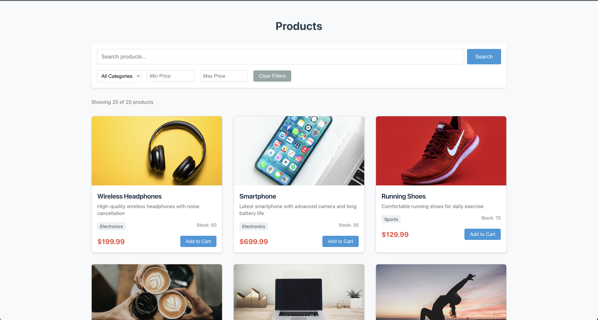

# Merchant frontend

A React 19/Vite storefront with products, cart, checkout, and order pages.
Ordinary browser API calls are public. This frontend does not generate TAP HTTP
signatures or establish consumer/payment authorization.

## Run

From this directory, using Node 22 or 24:

```bash
npm install
npm run dev
```

Vite listens on http://localhost:3000. Open http://localhost:3001 to browse through
the CDN proxy; the backend must also be running on port 8000. Follow the
[quickstart](../docs/quickstart.md) to seed products and start the services.

## Actual API configuration

`src/services/api.js` reads `VITE_API_BASE_URL`:

- In development, empty/unset means relative `/api/...` requests. Vite forwards
  these to the backend when browsing port 3000; the CDN proxy forwards them when
  browsing port 3001.
- An absolute value such as `http://localhost:8000` sends requests directly to that
  origin and bypasses the CDN proxy. Inspect any existing local `.env` setting.
- In a production build, empty/unset currently falls back to
  `http://localhost:8000`. Set a deliberate base at build time if exercising a
  different API origin; building the UI does not create a production proxy.

`VITE_CDN_PROXY_URL`, `VITE_API_URL`, and `VITE_DEBUG_MODE` are not read by the
current frontend. `vite.config.js` owns the development port/proxy configuration.
The API module includes `/api` in its paths; do not append `/api` to the base URL.

## TAP and route behavior

The CDN proxy gates network requests to `/product/:id`, while other storefront
pages and `/api/...` remain public. React client-side navigation can render the
product page without a new document request. To test a protected API request,
use `/agent-api/...` with a fresh per-request signature as explained in the
[proxy guide](../cdn-proxy/README.md).

The sample checkout uses the backend's local demonstration flow. Successful UI
completion is not proof of a real payment or a verified consumer container.

## Build and inspect

```bash
npm run build
npm run preview
```

The build output directory is `build/`; preview is a separate Vite process,
usually port 4173. The development proxy setup is not a production deployment
configuration. There is no active frontend test command in `package.json`;
`vite.config.js` has historical test settings but no corresponding test runner.
Build the app and manually exercise affected pages with demo data.



See [architecture](../docs/architecture.md) for service and authorization boundaries.
