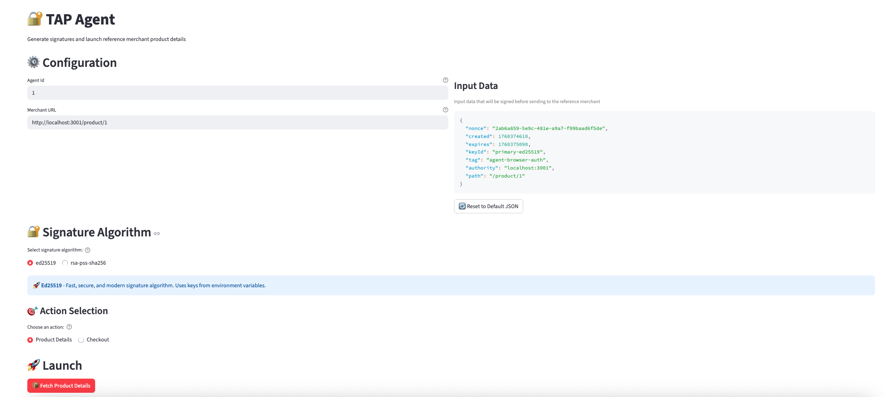

# TAP agent

An optional Streamlit UI that generates TAP request-recognition signatures and
uses Playwright to interact with the sample merchant. The browser flow is a
manual demonstration; signature tests do not certify the checkout automation.

For the fastest working signed request without a browser, use
[`scripts/demo_request.py`](../scripts/demo_request.py) and the
[quickstart](../docs/quickstart.md).

## Run the browser UI

Use Python 3.11 with the root requirements installed. From the repository root,
follow the quickstart to run the registry, backend, proxy, and frontend. With a
fresh local registry and no existing `tap-agent/.env`:

```bash
python scripts/demo_request.py --keyid primary-ed25519 --agent-env tap-agent/.env
python -m playwright install chromium
cd tap-agent
python -m streamlit run agent_app.py --server.port 8501
```

The script registers a matching local public key and creates a new env file with
mode 0600. It does not overwrite an existing env file. Open http://localhost:8501,
select Ed25519, use the reported agent ID, and set merchant URL to
`http://localhost:3001/product/1`. Generate/reset fresh input for each attempt.
The supplied env configuration enables Ed25519 only.

## Key configuration

| Input | Format and behavior |
| --- | --- |
| `ED25519_PRIVATE_KEY` | Standard Base64 of the raw 32-byte private seed |
| `ED25519_PUBLIC_KEY` | Standard Base64 of the matching raw 32-byte public key |
| `RSA_PRIVATE_KEY` | Matching RSA private key in PEM form; dotenv quoted multiline values are supported |
| `RSA_PUBLIC_KEY` | RSA public key in PEM `BEGIN PUBLIC KEY` form |

These are the environment variables the signer reads. Merchant URL is selected
in the UI; Streamlit's port is a CLI setting. `MERCHANT_API_URL`, `AGENT_PORT`,
and `DEBUG` do not configure the current app. Do not mistake OpenSSL PEM Ed25519
files for the raw Base64 values expected here.

The UI uses fixed key IDs: `primary-ed25519` for Ed25519 and `primary` for RSA.
The displayed Agent ID does not choose a different key. Register the matching
public key under the required ID in a fresh local registry, avoiding duplicate
key IDs across agents. The registry's public-key seed does not create private
keys matching your environment.

For RSA, generate a matching pair outside version control and place it in your
local env file; register the public key with the existing legacy
`rsa-pss-sha256` metadata. The sample uses SHA-256/MGF1-SHA-256 and maximum PSS
salt. This is distinct from registered `rsa-pss-sha512` behavior.

## Signature and automation boundaries

`tap_signature.py` owns canonical minimum-profile construction. `agent_app.py`
contains duplicate historical RSA signing function definitions; the later Python
definition wins. Use the shared helper and check all definitions when editing.
The Ed25519 function reads its key from the environment even though its signature
still has a historical `private_key_pem` parameter.

HTTP metadata uses lowercase `keyid`; the UI's displayed JSON uses an internal
`keyId` field. The signed minimum covers authority/path, not method/query/body.
The agent emits `agent-browser-auth` for browsing and `agent-payer-auth` for its
checkout action. A payer tag does not prove user consent or authorize payment.

The browser automation reuses configured headers while navigating. Supporting a
protected API workflow requires signing each target afresh and defining the
necessary operation/body coverage. The frontend's ordinary `/api` calls remain
public; successful checkout automation does not demonstrate signature enforcement
on every commerce operation. See [protocol](../docs/protocol.md).

## Validate and troubleshoot

From the repository root:

```bash
python -m unittest discover -s tap-agent/tests -v
npm --prefix cdn-proxy test
```

Tests generate throwaway keys, verify actual Python signatures in Node, and check
that private signing material does not appear in captured logs. They do not open
Streamlit or Playwright. Debug signature bases contain reusable proof metadata;
keep local logs private and do not add private-key logging.

For browser failures, check Chromium installation, all service ports, exact
merchant authority/path, matching registry/env keys, clock, and fresh nonce/input.
Use the [quickstart troubleshooting table](../docs/quickstart.md).


